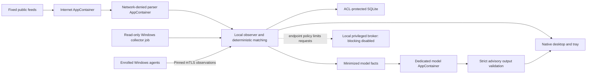

# Delivery status

This repository contains a runnable Windows observe-only preview and security primitives. The approved five-stage plan is **not fully implemented**. All enforcement remains unavailable.

| Plan area | Implemented | Remaining before the planned release |
|---|---|---|
| Foundation | Rust workspace; strict interfaces; pinned mTLS enrollment; broker service with protected state, authenticated local IPC and durable receipts; hosted elevated/standard-user service validation | Windows 11 elevated matrix; WFP lease journal integration; certificate rotation; audit replication |
| Isolation | AppContainer parser/fetch/model workers, Job limits, pipe handle allowlist; live parser conformance probe | Restricted collector identity; comprehensive OS isolation matrix; independent unsafe-wrapper review |
| Inventory/events | Native Windows read-only collection; hourly inventory; 30-second event polling with partial coverage | ETW/subscription-driven refresh; broader persistence/package coverage; update supersedence |
| Intelligence | CISA KEV, current-month MSRC, paginated incremental NVD, EPSS, explicit CVE/OSV queries, curated Chromium RSS | Historical bootstrap; complete withdrawn/rejected advisory reconciliation; OSV automatic inventory integration/pagination; broader curated research |
| Matching | Supported SemVer and simple desktop dotted ranges, conservative candidates, stale/conflict handling, KEV priority | Full Windows servicing graph; complex CPE environments; Debian/RPM/PEP440 semantics; curated validation corpus |
| LAN | Passive neighbors; up to ten enrolled observation clients; agent-initiated reporting; coordinator downtime backoff | Selected-interface active discovery and selected-target service checks; reliable classification of VPN/public/physical interfaces |
| Native UI | Desktop/tray, coverage, findings/evidence, devices, schedules, reports, audit history, settings and local stop control | Enrollment wizard; validated service lifecycle; accessible notification UX; usable active-block controls after broker integration |
| AI | Disabled by default; direct API/LAN adapters; minimal projection; hostile-output validation; request/token/cost reservations | Live configured-provider tests; multi-step constrained investigation executor; verified pricing integration; documented subscription adapter remains out of scope |
| Bounded actions | Pure authorization/limits; dynamic WFP lease cleanup; broker service/IPC with all proposals denied; request journal/replay/clock/quotas; separate WFP/watchdog fault harness and deterministic clock recovery tests | Evidence qualification, gated WFP integration, admin activation, production watchdog, transactional lease journal and actual Windows 11 reboot/sleep recovery validation |
| Updates | Pure signed-metadata/hash/expiry/rollback verifier | Authenticode, production trust roots, installer, staged rollout, key rotation, verified recovery |
| Acceptance | Unit/regression tests, loopback mTLS, real inventory/feed tests, parser AppContainer probe, native screenshot review | Full negative TLS/IPC matrix, sustained coverage-guided fuzzing, storage fault injection, WFP VM matrix, 72-hour soak, independent security review |

## Repository base

The user authorized creation of the public [qiyundai/VASP](https://github.com/qiyundai/VASP) repository after a source-only publication review. Its authoritative remote is `https://github.com/qiyundai/VASP.git`; its live default branch was verified as `trunk`. Query live remote HEAD, fetch the exact commit, and verify ancestry before dependent changes or release validation. Historical validation records before initial commit `015c8d1` refer to the former local-only workspace.

## Intended process flow

Keep the broker independently reviewable. Do not add arbitrary execution as a shortcut for missing inventory, remediation, or enforcement operations.

The next broker increment is described in [BROKER.md](BROKER.md). The updated desktop uses a Direct3D 12/FIFO renderer and a stable-height status area without a continuous busy spinner. The user reported the app-window flicker resolved after restarting into that build. The initial 72-hour observer soak continues on its original binary.

WFP/watchdog test scope and the still-pending real power-transition gates are described in [WFP-RECOVERY.md](WFP-RECOVERY.md). The gated fault-injection executable is never packaged with the preview.
